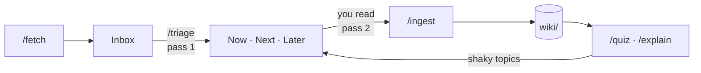
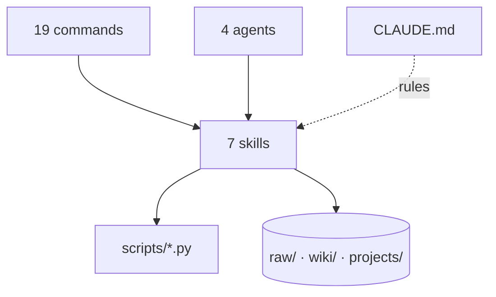

# paper-brain

A research-paper vault that an agent maintains for you, in plain markdown.
Papers come in from arXiv, get triaged into a queue, and once you have read
them they become linked wiki pages: one per paper, one per method, model and
benchmark, with every number recorded alongside the setting it holds under.
Then it quizzes you, so reading turns into knowing.

It is a paper-focused version of
[second-brain-os](https://github.com/undefined-ui/second-brain-os), which
implements [Karpathy's LLM-wiki pattern](https://gist.github.com/karpathy/442a6bf555914893e9891c11519de94f).
It runs in [Claude Code](https://code.claude.com/docs/en/setup); [Obsidian](https://obsidian.md)
is optional and only for browsing the graph.

## The reading loop



The passes follow S. Keshav's three-pass method from *How to Read a Paper* (ACM SIGCOMM CCR, 2007):

| Pass | You do | The agent does | Command | `status` |
|---|---|---|---|---|
| 0 | Find a paper | Downloads PDF + metadata, adds to Inbox | `/fetch` | `queued` |
| 1 | Nothing yet | Skims abstract, intro, figures, conclusion; files it Now, Next, Later or Skip with a reason | `/triage` | `queued` → `skimmed` |
| 2 | Read the paper | Asks your take first, then writes the paper page and links it to concepts, models, benchmarks | `/ingest` | `read` |
| 3 | Reimplement or work through proofs | Updates the page with what you found | `/ingest` again | `deep` |
| ∞ | Get tested | Quizzes you from your own pages, logs what is shaky | `/quiz`, `/explain` | |

## Quickstart

```bash
git clone <this repo> ~/papers && cd ~/papers
claude
```

Then, inside Claude Code:

```
/setup                       # 5-minute interview: interests, background, one reading goal
/fetch 1706.03762 2205.14135 # any arXiv ids or URLs
/queue                       # what to read next, and why
# ...read the paper...
/ingest 1706.03762           # it asks for your take, then files everything
/quiz recent
```

The skills, commands and agents live in `.claude/` inside the vault, so there
is nothing to install: Claude Code picks them up when you run `claude` in this
folder. To browse the graph, open the folder in Obsidian with "Open folder as
vault".

On Windows, use `python` where this README says `python3`.

## What is in here

```
CLAUDE.md                 the rules the agent follows in this vault
raw/papers/               PDFs + metadata, never edited (PDFs git-ignored)
raw/notes/                exported highlights and annotations
wiki/papers/              one page per paper you have read
wiki/concepts/            methods and ideas: self-attention, KV cache, RLHF
wiki/entities/            models, datasets, benchmarks, labs
wiki/synthesis/           lineages, comparisons, contradictions
wiki/index.md, log.md     catalog and history, kept current by the agent
output/                   surveys from /report, never part of the wiki
projects/paper-reading/   the pipeline: Inputs/queue.md, Process/, Outputs/, Feedback/
templates/                page templates
scripts/                  arxiv_fetch, link_path, paper_check, link_check, vault_stats (stdlib only)
examples/                 one fully ingested paper, to show the format
.claude/skills/           7 skills: the actual behaviour
.claude/commands/         19 thin slash commands pointing at the skills
.claude/agents/           4 subagents, 2 read-only
```



## Commands

| Stage | Command | What it does |
|---|---|---|
| Setup | `/setup` | Interviews you and fills in `CLAUDE.md` and the reading goal |
| Capture | `/fetch <ids>` | Downloads from arXiv into `raw/papers/`, then triages |
| | `/triage [id]` | First pass; files the paper in the queue with a reason |
| | `/queue` | Shows Now and Next and recommends what to read |
| Ingest | `/ingest [id]` | Your take first, then paper page, concepts, entities, links |
| Ask | `/ask <question>` | Answered only from your pages, every page cited |
| | `/compare <A> <B>` | Side-by-side table; refuses to compare mismatched settings |
| | `/connect <A> <B>` | The path between two methods through your pages, every hop explained |
| | `/timeline <concept>` | How an idea developed across the papers you have read |
| | `/contradictions [topic]` | Where papers disagree |
| | `/sources <claim>` | Which papers a claim rests on |
| Write | `/synthesize <topic>` | A lineage, comparison or contradiction page worth keeping |
| | `/report <topic>` | A mini-survey written to `output/`, gaps reported before writing |
| Learn | `/quiz [scope]` | Recall, mechanism and transfer questions from your pages |
| | `/explain <concept>` | You explain; it grades against your page |
| | `/skeptic <paper>` | Reviewer two, using only the rest of your vault |
| Maintain | `/lint` | Audit and fix what is mechanical |
| | `/health` | Five-line health check |
| | `/weekly` | What you read, what grew, what to read next |

## Agents

| Agent | Writes | Use |
|---|---|---|
| `ingestor` | yes | Background ingest; leaves your take pending for you |
| `linker` | links only | After several ingests, or weekly |
| `reviewer` | no | `/weekly` |
| `skeptic` | no | `/skeptic` |

## Rules that make it work

1. **Nothing is ingested until it is linked.** A paper page with no links to
   concepts is a summary, and summaries do not compound.
2. **No number without its setting.** Every result records benchmark, metric
   and condition, so `/compare` can tell when two numbers are not comparable.
3. **Your take is yours.** The agent asks for it before showing its summary
   and never writes it. Pages without one are listed in
   `projects/paper-reading/Feedback/to-explain.md`, and they are what `/quiz`
   goes after first.
4. **Contradictions are recorded, never overwritten.** When paper B disagrees
   with paper A, both stay, with years.

## A weekly rhythm

- Two or three times a week: read one paper from Now, then `/ingest` it.
- After each ingest: `/compact` (or `/clear`) before the next paper. Papers
  fill the context fast, and one paper per session keeps ingests accurate.
- Once a week: `/weekly`, then `/quiz` on what it lists.
- After about ten papers: `/lint`, and try `/synthesize` on the topic with the
  most papers. Once a topic has five or more, `/report` turns it into a
  mini-survey you can share with a reading group.

Give it ten papers before judging it. At three papers the graph is a line; at
ten on one topic, `/timeline`, `/connect` and `/compare` start answering
questions you could not answer from memory.

## Scripts

All dependency-free Python, run from the vault root.

| Script | What it does |
|---|---|
| `arxiv_fetch.py <ids>` | PDF + metadata into `raw/papers/`, line into the queue Inbox. `--no-pdf`, `--no-queue` |
| `link_path.py . <A> <B>` | Shortest paths between two pages through wikilinks, for `/connect`. Accepts titles and aliases |
| `paper_check.py .` | Missing arXiv id or year, results without conditions, pending takes, duplicates, queue drift |
| `link_check.py .` | Broken links, alias links Obsidian will not resolve, orphans, stubs |
| `vault_stats.py .` | Page counts by type, link density, orphan rate, most-linked pages |

## Credit

Structure, skills format and `link_check.py` / `vault_stats.py` are adapted from
[second-brain-os](https://github.com/undefined-ui/second-brain-os) (MIT). The
LLM-wiki pattern is Andrej Karpathy's. The three-pass method is S. Keshav's.

MIT licensed.
